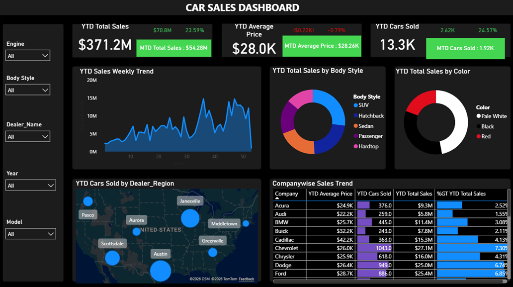

# 🚗 Car Sales Dashboard

---
## Project Overview
This project presents an executive-style Power BI dashboard for monitoring automotive sales performance. It combines KPI reporting, trend analysis, geographic visualization, and interactive filtering to support business decision-making.

---

## Dashboard Preview

---
## Dashboard Objectives
- Monitor Year-to-Date (YTD) sales performance
- Compare Month-to-Date (MTD) and YTD metrics
- Analyze weekly sales trends
- Analyze sales performance by body style and color
- Evaluate dealer performance by region
- Explore sales interactively using slicers

--- 
## Dashboard Features
### KPI Cards
- YTD Total Sales
- YTD Average Price
- YTD Cars Sold
- MTD Total Sales
- MTD Average Price
- MTD Cars Sold
### Visualizations
- Weekly Sales Trend
- Sales by Body Style
- Sales by Color
- Dealer Car Sales by Region
- Manufacturer Sales Performance Table
### Interactive Filters
- Engine
- Body Style
- Dealer Name
- Year
- Model

---
## Skills Demonstrated
- Power BI Dashboard Design
- DAX Time Intelligence
- Data Modeling
- Calendar Tables
- KPI Development
- Interactive Reporting
- Business Intelligence
- Data Visualization

---
## DAX Concepts Used
- TOTALYTD()
- TOTALMTD()
- SAMEPERIODLASTYEAR()
- Condtional Formatting
- Time Intelligence
- Calendar Table

---
## Key Business Insights
- Total sales for the most recent year of the dataset was approximately $371.2 million, about 24% higher than for the previous year
- Total cars sold for the most recent year of the dataset was approximately 13.3 million, about 25% higher than for the previous year
- Weekly sales generally increased as the year went on, peaking at approximately $14.6 million during the 36th week
- Austin is the region with the most car sales with 2296 cars sold
- A plurality of sales, approximately 47%, come from pale white cars

---
## Dataset Notice
This dashboard was created as a learning project using the dataset provided alongside the following tutorial:

https://www.youtube.com/watch?v=XnPo5Ft7RzQ

The dataset and Power BI project file are not included in this repository because I do not own them and could not verify redistribution rights.

--- 
## License
Everything posted here is covered under the MIT license but the external dataset and the tutorial remain the property of their respective owners. 

---

